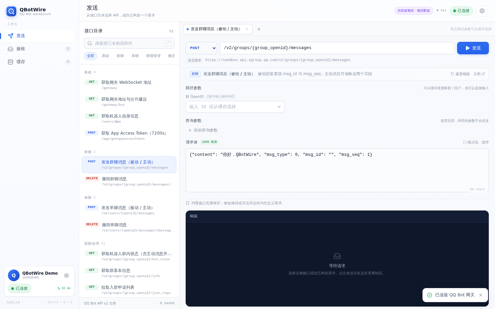
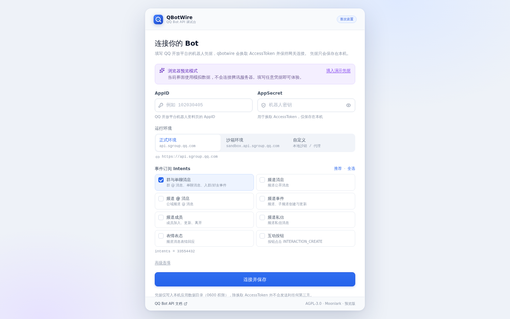
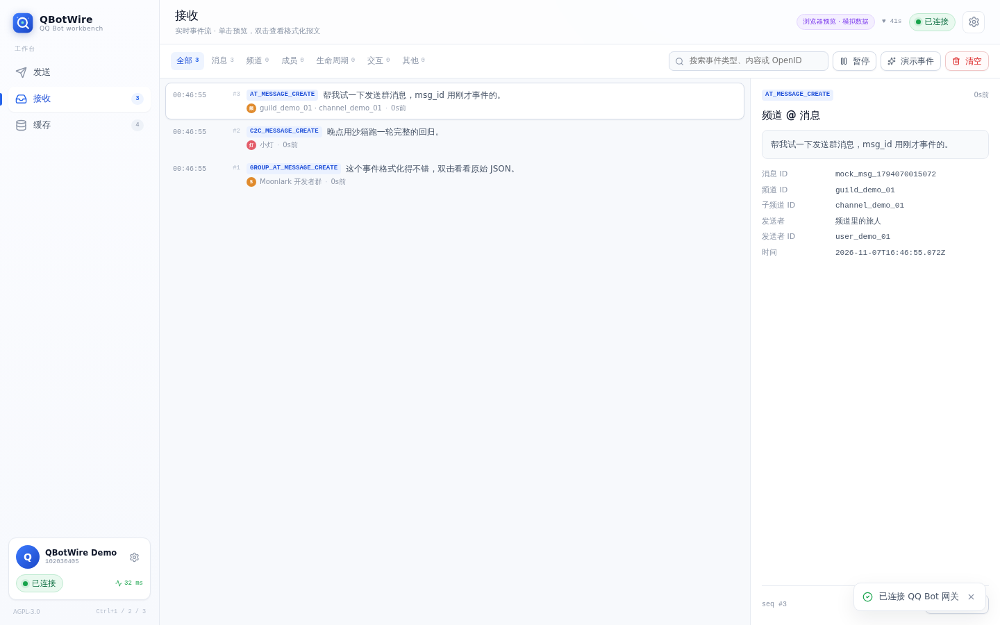
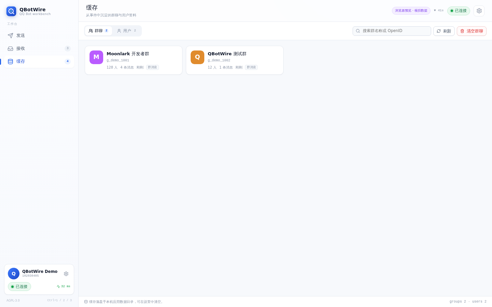
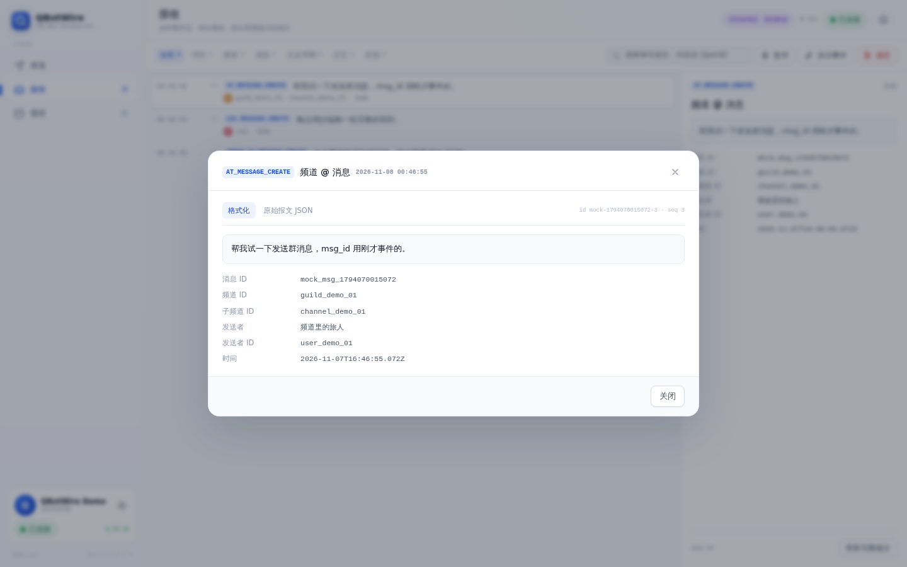

# Moonlark QBotWire

> 一个用于调试腾讯 QQ Bot API 的桌面工作台。

[](https://github.com/Moonlark-Dev/qbotwire/actions/workflows/ci.yml)
[](LICENSE)

QBotWire 首先是一个 QQ Bot：它换取 AccessToken、连接官方 WebSocket 网关并保持在线。
同时，它把收到的事件原样交回给你，并允许你从接口目录调用 API，或完全自己构造一个请求。



## 功能

### 发送

- 内置 **51 个 QQ Bot API v2 接口**，按「基础 / 群聊 / 单聊 / 群聊管理 / 频道 / 频道成员 / 频道身份组 / 频道私信 / 互动 / 富媒体」分组，支持搜索。
- 路径参数（`{group_openid}`、`{openid}` 等）会拆成独立输入框，**可从缓存里搜索群 / 用户**，也可以手动输入。
- 查询参数、JSON 请求体均可编辑；请求体提供模板、格式化和实时校验。
- 发送消息接口提供**消息构造弹窗**：可视化填写文本 / Markdown / Ark / Embed / 富媒体消息，支持模板参数、按钮、消息引用与被动回复 `msg_id`，实时预览并一键填入请求体。
- 请求体支持「插入 OpenID」：弹窗里搜索缓存中的用户或群聊，选中后直接插入到光标位置。
- **多标签页**：同时打开多个接口，各自保留请求与响应。
- 自定义请求成功后可以自动保存；也可以随时手动保存、更新、删除。已保存接口会出现在目录顶部的「已保存接口」里。
- AccessToken 由 Rust 后端自动换取、缓存并在过期前刷新；调用 API 时自动注入 `Authorization: QQBot <token>`。

### 接收

- 实时显示网关 `DISPATCH` 事件，支持按类别筛选、关键词搜索、暂停与清空。
- 已知事件（群 @ 消息、单聊、频道消息、入群、好友、互动……）会格式化为可读摘要和字段表。
- **双击事件**打开格式化报文，可在「格式化」与「原始报文 JSON」之间切换并一键复制。
- 格式化视图会在群 / 用户 OpenID 后面显示头像与名称小徽章：名称和头像优先用报文自带的数据，其次从本地缓存读取（悬停可查看 OpenID 与来源）。
- 网关支持 Hello / Identify / Heartbeat / Resume、断线自动重连和会话恢复。

### 缓存

- Bot 收到群消息或单聊消息时，自动沉淀群聊与用户资料：名称、OpenID、Union OpenID、头像、首次 / 最近出现、消息计数。
- 看到新的群聊时会尝试调用群信息接口补全群名与人数（失败不影响使用，可在缓存详情里手动重试）。
- 支持搜索、手动重命名、单个群信息刷新、按范围清空。
- 缓存落盘在本机应用数据目录，供发送页的 ID 选择器使用。

## 截图

| 首次连接 | 接收事件 |
| --- | --- |
|  |  |

| 缓存 | 事件报文 |
| --- | --- |
|  |  |

## 技术架构

```text
┌──────────────────────────────────┐
│  Vue 3 + TypeScript (WebView)    │
│  发送 / 接收 / 缓存 / 设置        │
└───────────────┬──────────────────┘
                │ Tauri IPC：invoke + event
┌───────────────▼──────────────────┐
│  Rust core（src-tauri）          │
│  auth      AccessToken 获取/刷新  │
│  api       REST 请求代理          │
│  gateway   WebSocket 网关客户端   │
│  cache     群/用户缓存与落盘       │
│  store     凭据、设置、已保存接口   │
└───────────────┬──────────────────┘
                │ HTTPS / WSS
        api.sgroup.qq.com / sandbox.api.sgroup.qq.com
```

- **桌面壳**：Tauri 2（Rust）
- **前端**：Vue 3 + TypeScript + Vite
- **网络**：`reqwest`（REST）、`tokio-tungstenite`（WSS，rustls）
- **持久化**：`config.json` / `cache.json`，Unix 下权限 `0600`

前端所有平台能力都经过 `src/lib/backend.ts` 的 `Backend` 接口。浏览器里运行时使用
`src/lib/mockBackend.ts` 的演示实现（模拟数据、不会联网），方便直接预览 UI；桌面端构建时
使用的始终是 Rust 后端。

## 开始使用

### 环境要求

- Node.js 20+（推荐 22）
- Rust 1.77.2+
- 各平台的 Tauri 依赖：https://tauri.app/start/prerequisites/

Linux（Debian / Ubuntu）：

```bash
sudo apt install libwebkit2gtk-4.1-dev libgtk-3-dev libayatana-appindicator3-dev \
  librsvg2-dev patchelf libssl-dev pkg-config
```

### 安装与开发

```bash
npm install
npm run tauri dev        # 启动桌面应用（自动运行 Vite）
```

只想看界面 / 在没有桌面环境的机器上预览：

```bash
npm run dev              # http://localhost:1420，浏览器模拟后端
npm run build            # 类型检查 + 生产构建
npm run preview          # 预览生产构建（0.0.0.0:4173）
```

### 打包

```bash
npm run tauri build
```

产物位于 `src-tauri/target/release/bundle/`。CI 会额外构建 Linux `deb` 与 Windows NSIS 安装包验证打包链路；
发布流程见 `.github/workflows/release.yml`。

## 首次连接

首次打开 QBotWire 会弹出连接窗口，需要填写：

- **AppID / AppSecret**：QQ 开放平台机器人资料页中的凭据。
- **运行环境**：正式环境、沙箱环境，或自定义 Base URL。
- **事件订阅 Intents**：默认只订阅群与单聊消息（`1 << 25`）。

提交后会依次完成：换取 AccessToken → 请求 `/users/@me` → 获取 `/gateway` → 建立 WSS 连接 →
发送 Identify。成功后凭据保存在本机，下次启动自动重连。

> 凭据保存在应用数据目录（Linux 为 `~/.local/share/dev.moonlark.qbotwire/config.json`），
> 不会上传到任何第三方。详见「安全说明」。

## 自定义环境

「自定义」环境用于本地沙箱或代理。Base URL 会直接用于所有 REST 请求，Token 地址默认为
`{Base URL}/app/getAppAccessToken`，也可以在高级选项里覆盖。搭配
[Moonlark QSandbox](https://github.com/Moonlark-Dev/qsandbox) 时填写 `http://127.0.0.1:5700`
即可完整联调网关事件、群聊消息和媒体接口。

## 测试

```bash
npm run typecheck
npm test                        # Vitest：事件格式化、接口目录、请求构造、JSON 高亮、表单
cargo test --manifest-path src-tauri/Cargo.toml   # Rust：URL、凭据、存储、缓存、zlib 帧
cargo clippy --manifest-path src-tauri/Cargo.toml --all-targets -- -D warnings
cargo fmt --manifest-path src-tauri/Cargo.toml --all -- --check
```

CI 见 `.github/workflows/ci.yml`：Web 类型检查 / 测试 / 构建，Rust fmt / clippy / 测试，
以及 Linux `deb` + Windows NSIS 打包。

## 目录结构

```text
src/                     Vue 3 前端
  components/            页面与可复用组件
  lib/apiCatalog.ts      内置 QQ Bot API 目录
  lib/events.ts          事件格式化
  lib/request.ts         请求标签页 / 参数 / 保存逻辑
  lib/backend.ts         Tauri 后端桥
  lib/mockBackend.ts     浏览器预览用模拟后端
  stores/app.ts          全局状态
src-tauri/
  src/api.rs             REST 代理与群信息
  src/auth.rs            AccessToken
  src/gateway.rs         WebSocket 网关与状态
  src/cache.rs           群/用户缓存
  src/store.rs           凭据、设置、已保存接口
  src/commands.rs        Tauri 命令
  tauri.conf.json        窗口与打包配置
```

## 已知限制

- 富媒体分片上传的「上传分片」接口需要二进制 body，QBotWire 不代传；上传文件本身可以用
  `file_data`（base64）或 `url` 走 JSON 接口。
- 不提供 Webhook 回调服务：QBotWire 走 WebSocket 网关。
- 内置接口目录参考 https://bot.q.qq.com/wiki/develop/api-v2/ ；不同机器人权限（如内邀接口）
  仍受 QQ 平台限制。
- 发布产物未做代码签名。

## 安全说明

- AppSecret 与 AccessToken 都是敏感信息。AppSecret 以明文 JSON 保存在本机（Unix `0600`），
  请勿将应用数据目录分享给他人。
- AccessToken 只保存在内存中，过期前自动刷新；错误日志不会打印 AppSecret 或 token。
- 发送页的「真实请求」地址会展示在界面上，但请求头中的 token 不会被渲染。

## License

AGPL-3.0-or-later，见 [LICENSE](LICENSE)。
